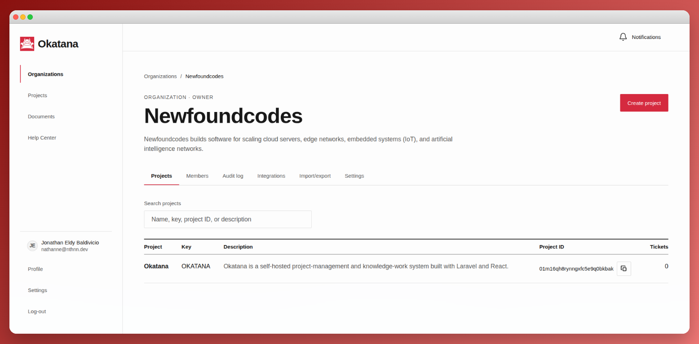

<div align="center">
  
  <h1>Okatana</h1>
  <p>
    <a href="https://github.com/newfoundcodes/okatana/actions"></a>
  </p>
</div>

Okatana is a self-hosted project-management and knowledge-work system built with Laravel and React. It combines organization and project access control, configurable Kanban workflows, tickets, documents, notifications, immutable audit history, portable data transfer, signed webhooks, and a scoped HTTP API in one deployable application.

<div align="center">
  
</div>

The default installation uses one SQL database for application data, sessions, cache entries, and queued jobs. Redis, a separate search service, and a runtime Node.js server are not required.

## Documentation

The repository includes two complementary documentation surfaces.

| Surface                | URL                  | Purpose                                                                     |
| ---------------------- | -------------------- | --------------------------------------------------------------------------- |
| MkDocs Material manual | `/docs/`             | User, administrator, operator, integration, developer, and reference guides |
| Scalar API reference   | `/docs/api`          | Interactive OpenAPI explorer and request client                             |
| OpenAPI document       | `/docs/openapi.yaml` | Raw OpenAPI 3.1 contract served by Laravel                                  |

Useful source documents include:

- [Documentation home](docs/index.md)
- [Product tour](docs/getting-started/product-tour.md)
- [Installation guide](docs/operations/installation.md)
- [Production checklist](docs/operations/production.md)
- [Architecture](docs/ARCHITECTURE.md)
- [HTTP API guide](docs/integrations/http-api.md)
- [External API endpoint reference](docs/API.md)
- [Webhook guide](docs/integrations/webhooks.md)
- [UI design system](docs/UI-DESIGN.md)
- [Environment-variable reference](docs/reference/environment.md)

MkDocs source lives in `docs/`, its configuration is `mkdocs.yml`, and generated output is written to the ignored `public/docs` directory. The OpenAPI source remains in `docs/openapi.yaml` but is excluded from static output so Laravel can enforce the configured documentation-access policy.

## Capabilities

### Workspace and access

- Multiple organizations with owner, admin, and user roles
- Explicit project membership for ordinary organization users
- Organization-wide visibility for owners and administrators
- Invitation lifecycle with expiration, revocation, and strong-password setup
- Configurable local TOTP enforcement after mandatory email verification
- Generic OAuth/OIDC support and a SAML adapter boundary
- Profile pictures, account preferences, and privacy-oriented personal-data export

### Project delivery

- Configurable project phases with ordering, visibility, completion state, and WIP limits
- Sequential project-local ticket identifiers
- Drag-and-drop Kanban movement and keyboard-accessible phase reordering
- Priorities, due dates, assignees, labels, lightweight tags, archive state, and reusable filters
- Gantt timelines and server-filtered analytics
- Rich-text descriptions and comments with links, images, mentions, and span-aware tables
- Private ticket and comment attachments up to 200 MB each
- Append-only ticket and comment revisions plus immutable movement history

### Documents and collaboration

- Organization-wide and project-scoped articles
- Draft, published, archived, and soft-deleted states
- Selected document editors and access-aware draft visibility
- Reusable organization-scoped document tags
- Mentions, comments, favorites, and collaboration notifications
- Authenticated PDF export with locally stored rich-text images embedded for rendering
- Searchable document audit and integration views

### Governance and automation

- Append-only organization and project audit records protected by application code and database triggers
- Versioned organization, project, and timeline import/export across supported databases
- Organization-scoped bearer credentials with explicit API scopes, expiry, revocation, and throttling
- HMAC-SHA256 outgoing webhooks with delivery history, retry backoff, secret rotation, and SSRF protection
- In-app and queued email notifications for assignments, mentions, comments, movement, invitations, and account verification

The complete behavioral documentation is maintained in the [MkDocs manual](docs/index.md), rather than duplicated in this README.

## Technology

| Layer               | Implementation                                         |
| ------------------- | ------------------------------------------------------ |
| Backend             | PHP 8.3+ and Laravel 13                                |
| Browser application | React 19 with TypeScript                               |
| Styling             | Tailwind CSS 4.3.3 and the Okatana Swiss design system |
| Asset pipeline      | Vite 8 and Node.js 22                                  |
| Databases           | SQLite, MySQL, or PostgreSQL                           |
| Background work     | Laravel queues, using the database driver by default   |
| Mail                | Laravel Mail and Notifications                         |
| API reference       | Scalar for Laravel and OpenAPI 3.1                     |
| Product manual      | MkDocs Material 9.7.7                                  |
| Container runtime   | Apache and PHP 8.4                                     |

Node.js and Python are build-time dependencies. The production runtime serves compiled React and MkDocs assets through Apache alongside Laravel.

## Domain and authorization model

```text
User
  └─ Organization membership (owner | admin | user)
       └─ Organization
            ├─ Project
            │    ├─ Explicit project members
            │    ├─ Workflow phases
            │    ├─ Labels and tags
            │    ├─ Tickets, comments, revisions, and attachments
            │    └─ Project-scoped documents
            ├─ Organization-wide documents
            ├─ Invitations and notifications
            ├─ Audit history and data transfers
            ├─ API credentials
            └─ Webhook endpoints and deliveries
```

| Capability                                 | Owner | Admin | User |
| ------------------------------------------ | ----- | ----- | ---- |
| Change organization settings               | Yes   | Yes   | No   |
| Delete an organization                     | Yes   | No    | No   |
| Manage members and invitations             | Yes   | Yes   | No   |
| Create and configure projects              | Yes   | Yes   | No   |
| Access organization projects implicitly    | Yes   | Yes   | No   |
| Access explicitly assigned projects        | Yes   | Yes   | Yes  |
| Configure project phases and access        | Yes   | Yes   | No   |
| Work with tickets in an accessible project | Yes   | Yes   | Yes  |
| Read permitted audit history               | Yes   | Yes   | Yes  |
| Manage API credentials and webhooks        | Yes   | Yes   | No   |

Backend authorization is authoritative. Frontend visibility is only a presentation convenience. The complete matrix and edge cases are documented in [Roles and permissions](docs/administration/roles-and-permissions.md) and the [permissions reference](docs/reference/permissions.md).

## Requirements

- PHP 8.3 or later
- Composer
- Node.js 22 and npm
- Python 3 with `venv` support for the documentation toolchain
- A PDO driver for SQLite, MySQL, or PostgreSQL
- PHP DOM, GD, JSON, OpenSSL, PDO, and XMLWriter extensions

The supplied Docker image installs the required PHP extensions and builds both frontend and documentation assets.

## Quick start

The default local configuration uses SQLite. From a fresh checkout, run:

```bash
cp .env.example .env
composer install
npm install
python3 -m venv .venv-docs
.venv-docs/bin/pip install -r requirements-docs.txt
php artisan key:generate
touch database/database.sqlite
php artisan migrate
composer serve
```

Open the following URLs after Laravel starts:

```text
Application   http://127.0.0.1:8000/
Manual        http://127.0.0.1:8000/docs/
Scalar API    http://127.0.0.1:8000/docs/api
```

`composer serve` performs a strict MkDocs build and an optimized Vite build before starting Laravel. It does not start a queue worker or the Vite development server. Run a worker separately when testing queued mail, notifications, or webhook delivery:

```bash
php artisan queue:work --tries=5 --timeout=90
```

Editor images and private attachments are streamed through authenticated Laravel routes. A `public/storage` symbolic link is not required for those features.

## Development workflow

Use the combined development command after installing the dependencies:

```bash
composer dev
```

It performs the documentation and optimized frontend pre-builds, then starts these long-running processes together:

- Laravel development server
- Database queue worker
- Vite development server with hot module replacement

The available build and serve commands are:

| Command                   | Behavior                                                        |
| ------------------------- | --------------------------------------------------------------- |
| `composer serve`          | Build MkDocs and optimized frontend assets, then start Laravel  |
| `composer dev`            | Run both builds, then start Laravel, the queue worker, and Vite |
| `composer docs:build`     | Run `mkdocs build --strict` through `.venv-docs`                |
| `composer frontend:build` | Run the optimized Vite production build                         |
| `npm run dev`             | Start only the Vite development server                          |
| `php artisan serve`       | Start only Laravel and skip both pre-builds                     |

For a documentation-only live preview with file watching, run:

```bash
.venv-docs/bin/mkdocs serve --dev-addr 127.0.0.1:8001
```

The preview runs on port `8001`. Its absolute `/docs/api` links stay on the preview origin, so open Scalar separately at `http://127.0.0.1:8000/docs/api` while using the standalone preview. In a normal Laravel or Docker deployment, the manual and Scalar share one origin.

## Database configuration

Okatana supports SQLite, MySQL, and PostgreSQL. All three engines receive database-level protection against updating or deleting audit rows.

### SQLite

```dotenv
DB_CONNECTION=sqlite
DB_DATABASE=/absolute/path/to/okatana/database/database.sqlite
```

If `DB_DATABASE` is omitted outside Docker, Okatana uses `database/database.sqlite`.

### MySQL

```dotenv
DB_CONNECTION=mysql
DB_HOST=127.0.0.1
DB_PORT=3306
DB_DATABASE=okatana
DB_USERNAME=okatana
DB_PASSWORD=replace-me
```

### PostgreSQL

```dotenv
DB_CONNECTION=pgsql
DB_HOST=127.0.0.1
DB_PORT=5432
DB_DATABASE=okatana
DB_USERNAME=okatana
DB_PASSWORD=replace-me
```

Apply schema changes after configuring the connection:

```bash
php artisan migrate
```

See [Database configuration](docs/operations/databases.md) for engine-specific operational guidance.

## Mail, queues, and account security

The default queue connection is database-backed:

```dotenv
QUEUE_CONNECTION=database
```

Queued work includes invitations, email-confirmation codes, workspace notification email, and webhook delivery. A production deployment must keep at least one queue worker running.

SMTP can be configured with Laravel's normal mail variables:

```dotenv
MAIL_MAILER=smtp
MAIL_SCHEME=tls
MAIL_HOST=smtp.example.com
MAIL_PORT=587
MAIL_USERNAME=okatana@example.com
MAIL_PASSWORD=replace-me
MAIL_FROM_ADDRESS=okatana@example.com
MAIL_FROM_NAME="Okatana"
```

New local signups must confirm ownership of their email address. Local authenticator enrollment and login challenges are controlled at runtime:

```dotenv
OKATANA_REQUIRE_TWO_FACTOR=true
OKATANA_EMAIL_CODE_TTL_MINUTES=12
OKATANA_EMAIL_CODE_RESEND_SECONDS=60
OKATANA_EMAIL_CODE_MAX_ATTEMPTS=8
```

TOTP and webhook secrets are encrypted with `APP_KEY`. Back up the key securely; losing it can make encrypted application data unrecoverable. See [Mail and queues](docs/operations/mail-and-queues.md) and [Account and sign-in](docs/user-guide/account-and-access.md) for the complete flows.

## OAuth and SSO

Okatana provides a generic OAuth 2.0/OIDC authorization-code flow with state validation, PKCE S256, configurable provider endpoints, scopes, identity-field mappings, and verified-email enforcement. Providers can be registered in `config/okatana.php` or through `OKATANA_OAUTH_PROVIDERS_JSON`.

The callback format is:

```text
<APP_URL>/auth/oauth/{provider}/callback
```

SAML integrations implement `App\Contracts\SsoDriver` and are registered with `OKATANA_SAML_DRIVER_CLASS`. Okatana does not implement SAML assertion validation itself; adapters must delegate signature, certificate, issuer, audience, replay, and clock-skew checks to a maintained SAML implementation or identity-provider SDK.

See [OAuth and SSO](docs/operations/oauth-sso.md) for configuration examples and security requirements.

## Deployment

Okatana can be deployed on a traditional PHP host or with the supplied multi-stage Docker image. In both models, the web process and queue worker must use the same release, environment, database, persistent storage, and `APP_KEY`.

### Traditional host

Point the web server's document root at the repository's `public` directory. Never expose the project root, `.env`, `storage`, source documentation, or dependency directories directly. The deployment user must be able to write to `storage` and `bootstrap/cache`.

Install production dependencies and generate the deployable frontend and documentation assets before switching traffic to the release:

```bash
composer install --no-dev --prefer-dist --no-interaction --optimize-autoloader
npm ci
python3 -m venv .venv-docs
.venv-docs/bin/pip install -r requirements-docs.txt
npm run build
.venv-docs/bin/mkdocs build --strict
php artisan migrate --force
php artisan optimize
php artisan queue:restart
```

This produces the optimized React bundle in `public/build` and the MkDocs manual in `public/docs`. The build deliberately leaves `public/docs/api` and `public/docs/openapi.yaml` absent so Laravel continues to own the Scalar and OpenAPI routes.

Run the HTTP application through Apache with `mod_rewrite`, Nginx with a Laravel front-controller configuration, or another supported PHP deployment platform. Configure the server to:

- serve existing files and directory indexes from `public`;
- route non-existent paths to `public/index.php`;
- redirect `/docs` to `/docs/` so MkDocs assets resolve correctly;
- preserve the forwarded HTTPS scheme and canonical host;
- allow request bodies large enough for the configured attachment limits;
- deny directory listing and access to hidden or source files.

Keep the queue worker under a process supervisor and restart it after each code deployment:

```bash
php artisan queue:work --sleep=2 --tries=5 --timeout=90
```

Preserve `.env`, `APP_KEY`, the selected SQL database, and persistent storage across releases. Atomic release directories with a stable shared environment and storage directory are recommended where the hosting platform supports them.

### Standalone Docker Image

You can build and run Okatana as a single, standalone container. A `.env` file must be passed at runtime since it is deliberately excluded from the image for security.

```bash
cp .env.example .env
php artisan key:generate  # Generate APP_KEY in your local .env

docker build -t okatana-app .

# We name the container 'okatana' so it's easy to reference later
docker run -d --name okatana -p 8000:80 --env-file .env okatana-app
```

The application will be exposed at `http://localhost:8000`.

To stop, start, or restart the container later, use the name assigned above:

```bash
docker stop okatana
docker start okatana
docker restart okatana
```

### Docker Compose

The base Compose configuration runs Apache/Laravel, a queue worker, SQLite storage, and persistent application storage.

```bash
cp .env.example .env
docker compose build
docker compose run --rm -e OKATANA_AUTO_MIGRATE=false web php artisan key:generate --show
```

Copy the generated value into `APP_KEY` in `.env`, then start the deployment:

```bash
docker compose up -d
```

The application is exposed at `http://localhost:8000`. The image builds the React application and MkDocs manual in dedicated build stages before assembling the Apache/PHP runtime.

Use the database overlays when SQLite is not appropriate:

```bash
docker compose -f docker-compose.yml -f docker-compose.mysql.yml up -d --build
```

```bash
docker compose -f docker-compose.yml -f docker-compose.postgres.yml up -d --build
```

Change the default overlay database passwords before deployment. Detailed storage, migration, health-check, and reverse-proxy guidance is in [Deploy with Docker](docs/operations/docker.md).

### Deployment verification

After switching traffic, verify the application from both the host and an external client:

```bash
php artisan about
php artisan migrate:status
php artisan queue:failed
```

Confirm that:

- `/up` reports a successful health response;
- sign-in, CSRF-protected mutations, and logout work over the canonical HTTPS origin;
- `/docs/` loads with styled assets and `/docs` redirects to it;
- `/docs/api` and `/docs/openapi.yaml` follow the configured public or authenticated policy;
- the queue processes a test email or notification;
- an authorized file can be uploaded and downloaded;
- a signed webhook delivery reaches a controlled receiver;
- logs, storage, database backups, and rollback procedures are available.

See the [production deployment guide](docs/operations/production.md) for proxy headers, Laravel caching, monitoring, backup, rollback, and acceptance checks.

## HTTP surfaces

Okatana deliberately separates browser requests from external automation.

| Surface              | Authentication                    | Purpose                            |
| -------------------- | --------------------------------- | ---------------------------------- |
| `/app/*`             | Laravel session                   | React application routes           |
| `/app-api/*`         | Laravel session and CSRF          | Same-origin browser JSON API       |
| `/api/v1/*`          | Okatana bearer credential         | Versioned external integration API |
| `/docs/`             | Static by default                 | Generated product manual           |
| `/docs/api`          | Configurable documentation access | Scalar API reference               |
| `/docs/openapi.yaml` | Configurable documentation access | OpenAPI source response            |
| `/up`                | None by default                   | Laravel health endpoint            |

External API credentials have the form:

```text
oka_<public-id>.<secret>
```

The complete token is shown only when created. Okatana stores the public identifier and a SHA-256 hash of the secret portion. Credentials are organization-scoped and can carry explicit scopes, expiry, revocation state, last-used time, and request throttling.

Use the [HTTP API guide](docs/integrations/http-api.md), [endpoint reference](docs/API.md), [OpenAPI source](docs/openapi.yaml), or the live Scalar page at `/docs/api` when building an integration.

## Webhooks

Organization owners and administrators can create organization-wide or project-specific webhook endpoints. Each delivery includes these headers:

```text
X-Okatana-Event
X-Okatana-Delivery
X-Okatana-Timestamp
X-Okatana-Signature
```

The signature contract is:

```text
sha256=HMAC_SHA256(secret, timestamp + "." + raw_body)
```

Consumers should verify the signature with a constant-time comparison and reject timestamps outside their accepted replay window. Endpoint creation rejects localhost, private or reserved addresses, and unresolved hosts by default. Set `OKATANA_WEBHOOK_ALLOW_PRIVATE_NETWORKS=true` only for an installation that intentionally delivers to internal networks.

See the [webhook guide](docs/integrations/webhooks.md) and [events and scopes reference](docs/reference/events-and-scopes.md) for payloads, retry behavior, and the current selector catalog.

## Import, export, and upgrades

Portable exports use the versioned `okatana.export.v1` JSON format instead of database-specific dumps. Organization and project graphs can include members, workflow data, tickets, revisions, attachments, documents, comments, audit history, and referenced rich-text assets. Imports regenerate local identifiers, remap relationships, re-sanitize HTML, and invite missing users where appropriate.

Portable exports complement backups; they do not replace a database, storage, and `APP_KEY` backup. See [Import and export](docs/administration/import-export.md) and [Backup and restore](docs/operations/backup-restore.md).

After pulling application changes, update dependencies and generated assets before restarting workers:

```bash
composer install
npm install
.venv-docs/bin/pip install -r requirements-docs.txt
php artisan migrate --force
composer docs:build
composer frontend:build
php artisan queue:restart
```

Review release-specific migration and rollback requirements before applying this sequence to production.

## Security model

The principal controls include:

- Laravel session authentication and CSRF protection for browser mutations
- Rate limiting for authentication, invitation, security, and external API endpoints
- Mandatory email ownership verification for new local accounts
- Configurable RFC 6238 TOTP enrollment and replay-aware login challenges
- Strong password rules and one-way invitation/API secret storage
- Encrypted TOTP and webhook secrets
- Organization isolation and explicit external API scopes
- Backend authorization for privileged organization, project, document, comment, attachment, and integration operations
- Server-side rich-text sanitization and relationship validation
- Private attachment downloads through authorized Laravel routes
- HMAC-signed, timestamped webhook requests and guarded outbound destinations
- OAuth state and PKCE validation plus verified-email enforcement
- Application- and database-level audit immutability
- Last-owner, WIP-limit, import-version, and cross-organization invariants

Security-sensitive deployment guidance is maintained in the [security model](docs/developer/security.md) and [production checklist](docs/operations/production.md).

## UI design system

The React application, MkDocs manual, and Scalar reference share Okatana's Swiss International Style system. The design uses a responsive 4/8/12-column guide, an 8px spacing rhythm, a neutral palette with one functional accent, square controls, typographic navigation, horizontal-rule tables, tabular numerals, restrained motion, and visible keyboard focus.

Canonical application tokens live in `tailwind.config.js`; global application styles live in `resources/css/app.css`; MkDocs overrides live in `docs/assets/stylesheets/okatana.css`; Scalar overrides live in `config/scalar.php`.

Run the source-level conformance check with:

```bash
npm run ui:audit
```

See [UI-DESIGN.md](docs/UI-DESIGN.md) for rules, accessibility behavior, and intentional exceptions.

## Project structure

```text
app/
  Contracts/                 SSO extension contracts
  Http/Controllers/          Browser and external API controllers
  Http/Middleware/           API, account-security, and docs access boundaries
  Jobs/                      Queued webhook delivery
  Models/                    Eloquent domain models
  Notifications/             Account, invitation, and workspace notifications
  Services/                  Authorization, audit, transfer, security, and collaboration logic
bootstrap/                   Laravel application bootstrap
config/                      Application, integration, Scalar, and framework configuration
database/
  migrations/                Portable schema and audit-protection triggers
docker/                      Container entrypoint and PHP upload configuration
docs/                        MkDocs sources and OpenAPI contract
public/                      Web root and generated build outputs
resources/
  css/                       Global Tailwind and rich-text styles
  js/
    components/              Shared and domain React components
    lib/                     Browser API, state, chart, modal, and editor helpers
    pages/                   Route-level React pages
    types/                   TypeScript declarations
routes/
  web.php                    SPA, session API, authentication, and OpenAPI routes
  api.php                    External bearer-token API
scripts/                     Source-level design audit
tests/                       PHPUnit feature and unit coverage
Dockerfile                   Multi-stage frontend, docs, Composer, and runtime image
mkdocs.yml                   Documentation information architecture and theme configuration
server.php                   Local static-doc and Laravel routing shim
```

## Important implementation files

| File                                         | Responsibility                                              |
| -------------------------------------------- | ----------------------------------------------------------- |
| `app/Services/AuthorizationService.php`      | Organization, project, and comment authorization invariants |
| `app/Services/ActivityRecorder.php`          | Audit insertion and matching webhook fan-out                |
| `app/Services/DocumentAccessService.php`     | Document query and object visibility                        |
| `app/Services/DataTransferService.php`       | Versioned graph import and export                           |
| `app/Services/HtmlSanitizer.php`             | Server-side rich-text allow list                            |
| `app/Services/MentionService.php`            | Mention validation, persistence, and notification fan-out   |
| `app/Services/NotificationService.php`       | In-app and email notification delivery                      |
| `app/Services/OutboundUrlGuard.php`          | Webhook destination and SSRF checks                         |
| `app/Services/AccountSecurityService.php`    | Email verification and TOTP policy                          |
| `resources/js/app.tsx`                       | React entry point and workspace shell                       |
| `resources/js/components/Primitives.tsx`     | Shared UI primitives and grid signature                     |
| `resources/js/components/RichTextEditor.tsx` | WYSIWYG editing, mentions, images, and tables               |
| `resources/js/pages/ProjectPage.tsx`         | Project board, analytics, Gantt, audit, and settings        |
| `resources/js/pages/DocumentsPage.tsx`       | Document workspace and directories                          |
| `routes/web.php`                             | Browser application and same-origin API routes              |
| `routes/api.php`                             | External API routes                                         |
| `docs/openapi.yaml`                          | OpenAPI 3.1 source of truth                                 |
| `mkdocs.yml`                                 | Documentation navigation, theme, plugins, and output        |
| `server.php`                                 | Local directory redirect and Laravel route preservation     |

## Testing and quality

Run the application and documentation checks before release:

```bash
composer run test
npm run build
npm run lint
npm run ui:audit
composer docs:build
docker compose config --quiet
```

The PHPUnit suite covers account security, role authorization, project visibility, tickets, tags, attachments, revisions, analytics, documents, notifications, external API behavior, webhook signing, audit presentation, and database-level audit immutability.

Strict MkDocs builds fail on documentation warnings. The UI audit checks application, Scalar, and MkDocs sources for canonical tokens and prohibited visual patterns. The full quality strategy is documented in [Testing and quality](docs/developer/testing.md).

## Production essentials

Before exposing Okatana to the Internet:

- use `APP_ENV=production` and `APP_DEBUG=false`;
- generate and protect a unique `APP_KEY`;
- terminate HTTPS at a trusted proxy or load balancer;
- set the canonical `APP_URL` and secure session-cookie options;
- configure a production mail transport and supervised queue workers;
- keep application and authenticator clocks synchronized;
- back up the SQL database, persistent storage, and `APP_KEY` together;
- restrict database and internal service network access;
- keep private-network webhook delivery disabled unless explicitly required;
- review whether the static `/docs/` manual should be protected at the reverse proxy;
- run migrations, tests, frontend compilation, and the strict documentation build;
- cache Laravel configuration, routes, and views only after final environment values are present;
- restart queue workers after deploying application code;
- smoke-test `/up`, authentication, queued mail, files, `/docs/`, Scalar, and one signed webhook delivery.

Use the detailed [production checklist](docs/operations/production.md), [backup and restore guide](docs/operations/backup-restore.md), and [troubleshooting guide](docs/operations/troubleshooting.md) during deployment planning.

## License

Okatana is distributed under the GNU Affero General Public License, version 3. See [LICENSE](LICENSE) for the complete terms.
